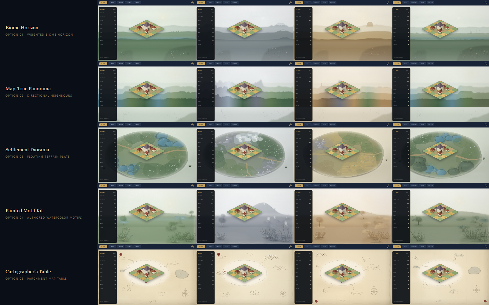
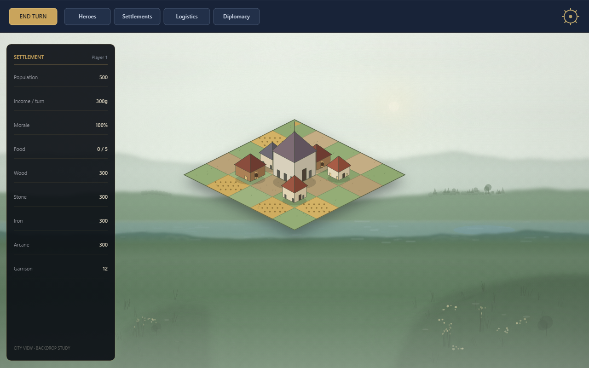
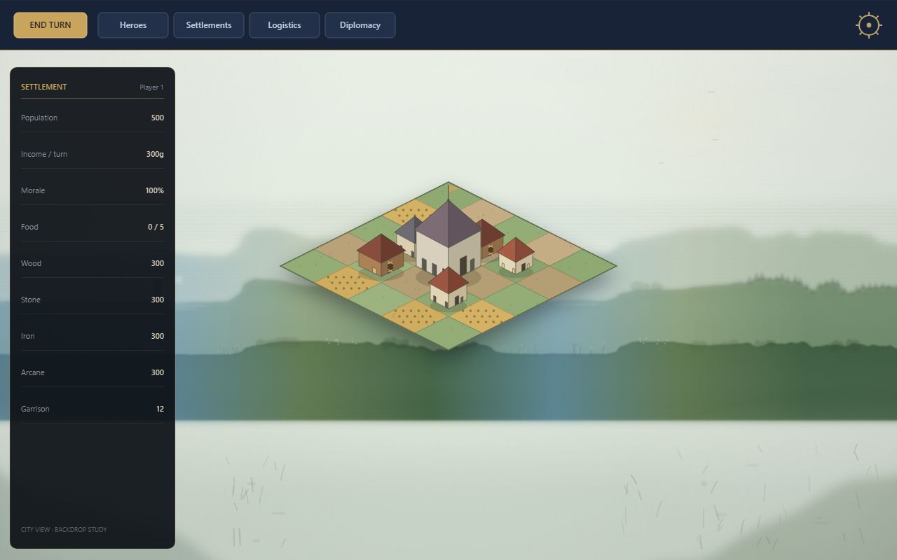
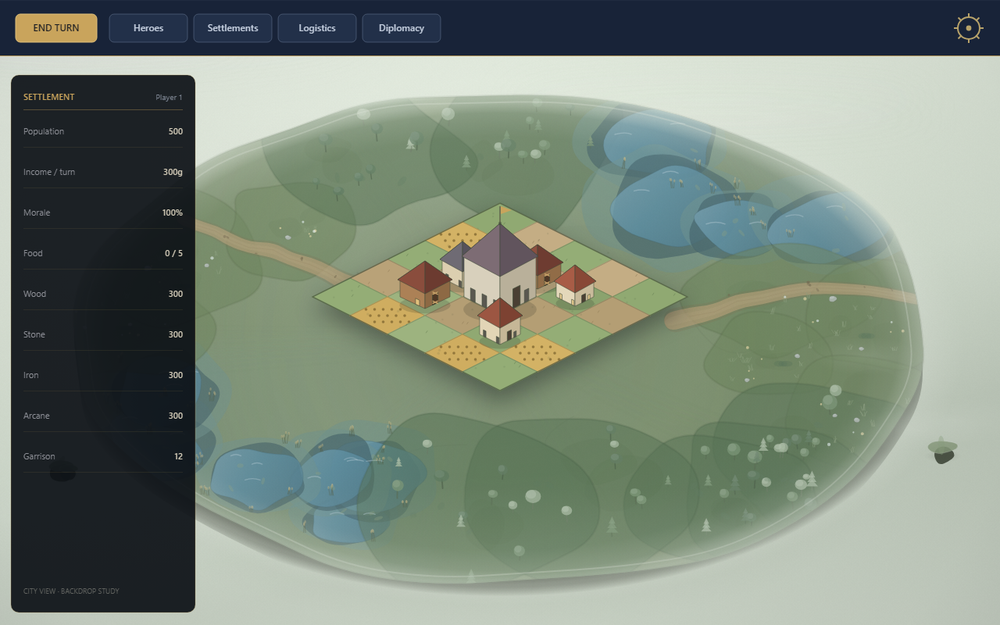
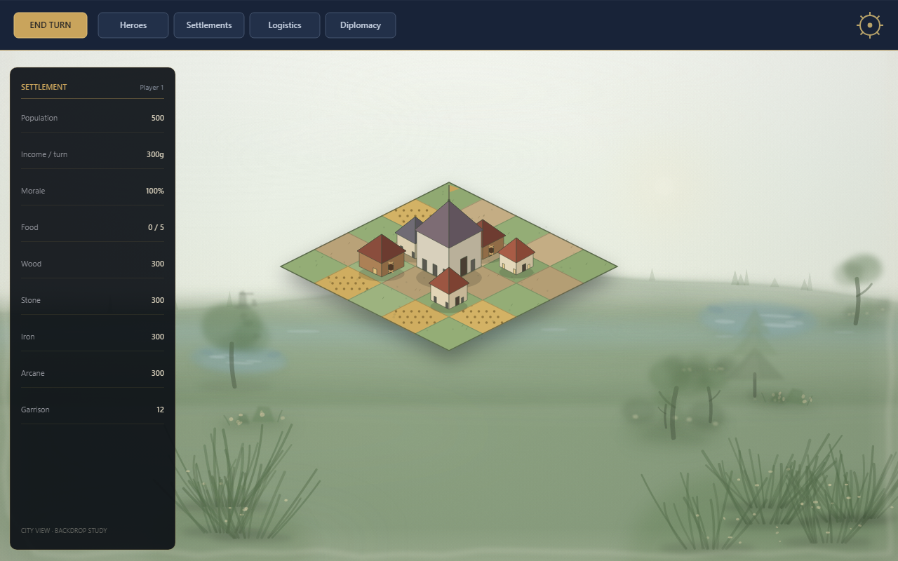
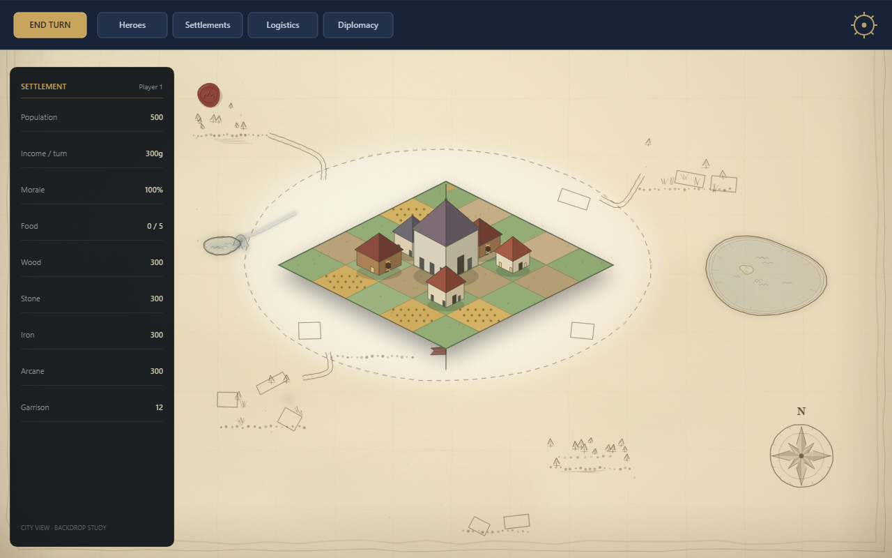

# City View Backdrop — Five Style Options

This is a design study only; no product code changed.

## The brief

> "Spin up the game and look at the background behind the grid in cityview. I want you to research and be creative and come up with a few options of styles. A couple could be based off of what Deadlock does for their city view equivalent. It has one generated based on the tile biome, and the surrounding tile biomes, and a little bit of procedural generation. It's not high detail but it gives each city view a unique feel."

The current city view uses one of four static watercolor landscapes, selected globally in settings (`spriteVariant`), not per settlement. The 1280x800 overlay has a ~72px top bar and a ~240px left panel; the opaque 5x5 city grid is centered around (640, 380). The screenshots in this folder render the same simplified grid + chrome over each option so only the backdrop changes.

## What Deadlock (1996) actually does

The user clarified this means *Deadlock: Planetary Conquest* (Accolade, 1996), not Valve's 2026 game. Its "city view" is the Settlement View: an isometric colony diorama on a square grid, with a fixed camera, where the player places buildings and watches colonists move through the settlement.

- Planet generation picks a biome and terrain mix: plains, forests, mountains, swamps, and oceans, ranging from tropical to ice worlds.
- Each territory has a small settlement terrain map. The Deadlock II MAP format stores 36 tiles per territory with types such as clear, rough, lightly wooded, densely wooded, rocky, worthless, and wet, plus bonus-resource squares. World types include earth-like, tropical, martian, icy, dry, volcanic, and alien.
- The unique feel comes from terrain composition, world palette, authored tile and prop art, and the player's own layout. It does not come from a high-detail procedural skyline.
- There is no documented parallax skyline, weather system, or building-placement grammar. Using the surrounding tile biomes to influence the backdrop is a reasonable extension of the idea, not a confirmed original mechanic.

Sources: the [Deadlock manual](https://archive.org/details/Deadlock_-_Manual_-_PC), the OpenDeadlock Decode Wiki [MAP File](https://sourceforge.net/p/opendeadlock/decode-wiki/MAP%20File/) reference, [OpenDeadlock legacy reference screenshots](https://github.com/UberNick/opendeadlock/tree/main/docs/reference/legacy-screenshots/nick-2026-06-27), and [Wikipedia](https://en.wikipedia.org/wiki/Deadlock:_Planetary_Conquest).

## Prototype method

Five Canvas2D renderers, all deterministic (FNV-1a + mulberry32) from a fake settlement signature: the center biome, six neighbor biomes, and a seed. Four scenarios drive the captures: River Capital (grass, with water and forest neighbors), Highland Hold (mountain, with snow and forest neighbors), Desert Crossroads (desert, dirt, and mountain), and Marsh Refuge (swamp, water, and forest). The same seed always produces the same backdrop. The interactive page is `index.html`; `node capture.mjs` regenerates the screenshots.

## The five options

## 1. Biome Horizon

**Concept:** A weighted biome horizon — the simplest translation of the map signature into a landscape.

**How it works:** The center tile counts twice and each of the six neighbors once, producing a dominant and secondary biome. Sky, sun, and three watercolor ridge layers derive from those weights, while neighbor motifs blend in at lower weight: trees, peaks, lake glints, dunes, reeds, and snow caps. The renderer seeds the ridge phase, sun position, a small landmark, and a few birds so neighboring settlements do not repeat.

**What changes per city:**
- Dominant and secondary biome palettes.
- Ridge silhouettes and the height of each watercolor layer.
- Neighbor motif accents and their blend strength.
- Seeded ridge phase, sun position, landmark choice, and bird placement.

**Pros**
- Closest to the existing watercolor art direction.
- Smallest step from today's four static variants.
- No new art assets required.
- Naturally varied and cheap to render and cache.

**Cons / risks**
- Least city-specific: neighbors only shift palette and motifs.
- Can read as a generic landscape rather than a place.
- The sky can feel empty at 1280x800.
- Procedural watercolor quality is hard to match to the authored variants.

**Cost / art dependency:** Medium renderer work, no asset dependency.

**Best for:** Shipping a per-settlement backdrop quickly without changing the art pipeline.

**Contact sheet:** [Four-biome sheet](screenshots/contact--biome-horizon.png)

## 2. Map-True Panorama

**Concept:** A directional panorama that turns the six neighboring tiles into a readable left-to-right horizon.

**How it works:** The six neighbors map to six horizontal sectors across the visible width, and adjacent ridgelines blend with smoothstep. Water can sit flat on one side while mountain and snow rise on the other. A landmark anchors the most dramatic sector, and a river appears only when water is dominant.

**What changes per city:**
- The left-to-right ordering of neighbor biomes.
- The height and slope profile of each sector.
- Landmark type and placement.
- River presence and path when water is dominant.
- Palette transitions between adjacent sectors.

**Pros**
- The most legible "this city is on the map" option.
- Left/right geography tells a story: a lake west, peaks east.
- Still reads as watercolor.
- Strong with distinctive biome rings.

**Cons / risks**
- The prototype's lower half is the weakest of the set — a flat foreground band.
- Sector seams and low-detail bands can look abstract.
- Landmarks need art to feel intentional.
- The orientation or rotation may confuse players; it needs a dedicated foreground pass.

**Cost / art dependency:** Medium-high renderer work; no new assets for v1.

**Best for:** Making the surrounding geography readable, not just mood.

**Contact sheet:** [Four-biome sheet](screenshots/contact--map-true-panorama.png)

## 3. Settlement Diorama

**Concept:** A floating organic terrain plate around the city, with no skyline at all.

**How it works:** Terrain patches in eight sectors map to the six neighbor biomes: water pools, forest clusters, rock and snow ridges, dunes and cacti, swamp pools, and grass with flowers. Paths lead outward from the city, and mist hides the edge beyond the plate. The result is a diorama that treats the settlement as a physical object sitting on the map.

**What changes per city:**
- The silhouette and extent of the floating plate.
- Which terrain type occupies each of the eight sectors.
- Prop mix: trees, rocks, cacti, reeds, flowers, snow caps.
- Path routing from the city edge outward.
- Mist density and edge treatment.

**Pros**
- Closest to Deadlock's Settlement View.
- Strongest "each city is a unique place" feeling.
- Directly uses the map neighborhood.
- Works with the pixel-art buildings and avoids the skyline cliché.

**Cons / risks**
- Competes with the grid for attention.
- Needs a large terrain and prop vocabulary to avoid repetition.
- The prototype plate is a flat 2D approximation and needs a stronger cliff/edge.
- Harder to keep the center calm; production art cost is high.

**Cost / art dependency:** High if authored (procedural v1 is medium).

**Best for:** The most distinctive, game-specific city view if we are willing to invest in terrain art.

**Contact sheet:** [Four-biome sheet](screenshots/contact--settlement-diorama.png)

## 4. Painted Motif Kit

**Concept:** Authored watercolor layer kits composed per settlement.

**How it works:** A far mass is placed from seeded control points, the midground is built from two or three stamp functions per biome (deciduous/conifer, mesa/dune/cactus, lake/reeds, willow/pool, glacier/pine, hedge/boulder), and the foreground adds grass and flowers. The neighbor family is blended at 25–35% so the surrounding map still colors the scene without overpowering the center biome.

**What changes per city:**
- Which biome kit supplies the far, mid, and foreground layers.
- Far-mass silhouette from seeded control points.
- Midground stamp clusters and their density.
- Foreground grass and flower scatter.
- Neighbor-family blend ratio and layer ordering.

**Pros**
- Highest art quality and lowest visual risk if we generate the biome kits.
- Preserves the current watercolor identity.
- Procedural composition still gives per-city variety.
- Predictable performance with preloaded layers.

**Cons / risks**
- Needs a biome asset kit (8 biomes × 2–3 layers), i.e. real art production.
- Repetition appears after many cities.
- Stamp placement can look collage-y.
- The prototype is a rough simulation and currently too hazy and sparse; asset weight is also a concern.

**Cost / art dependency:** Medium code plus high art generation (the existing FLUX/watercolor pipeline helps).

**Best for:** A production-safe upgrade of the current variants to per-settlement backdrops.

**Contact sheet:** [Four-biome sheet](screenshots/contact--painted-motif-kit.png)

## 5. Cartographer's Table

**Concept:** A living hand-drawn map on parchment.

**How it works:** Neighbor directions become coastlines, rivers, tree glyphs, mountain chevrons, dunes and cacti, swamp tufts, and snow peaks. The city sits on a cleared plot with a dashed boundary, roads, a compass rose, a wax seal, and subtle ink jitter. The backdrop behaves less like a landscape and more like the map the settlement was founded from.

**What changes per city:**
- Coastline and compass orientation.
- Glyph distribution for each neighbor biome.
- Road network leaving the cleared plot.
- Wax seal, labels, and ink-jitter seed.
- Parchment tone and ink intensity.

**Pros**
- Strongest thematic identity.
- Ties directly to the game's charter, map, and banner language.
- Very memorable and cheap to render.
- High contrast keeps the city readable; unique per settlement.

**Cons / risks**
- Biggest style shift from the watercolor and pixel-art mix.
- Map glyphs can look sparse or abstract.
- Legibility and contrast need testing against the real chrome.
- Less of a landscape and more of a UI/map surface; may not satisfy the biome-backdrop brief as directly.

**Cost / art dependency:** Medium ink/glyph vocabulary; no image assets.

**Best for:** A brand-defining wildcard if the game leans into cartography.

**Contact sheet:** [Four-biome sheet](screenshots/contact--cartographers-table.png)

## Comparison table

| Option | Unique per city | Deadlock fidelity | Art risk | Code cost | Asset cost | Fit with current watercolor style | Readability behind grid |
|---|---|---|---|---|---|---|---|
| **1. Biome Horizon** | Medium (palette and motifs shift) | Medium (biome-driven mood) | Medium (procedural watercolor match) | Medium | None | High | High |
| **2. Map-True Panorama** | High (directional geography) | High (neighbor terrain reads) | Medium (foreground band) | Medium-High | None/Low | High | Medium |
| **3. Settlement Diorama** | High (sector terrain plate) | High (closest to Settlement View) | High (terrain/prop volume) | Medium (v1) / High (prod) | High | Medium | Medium |
| **4. Painted Motif Kit** | Medium-High (kit composition) | Medium (biome art, no diorama) | Low (authored kits) | Medium | High | High | High |
| **5. Cartographer's Table** | High (map glyph layout) | Low-Medium (thematic, not literal) | Medium (glyph legibility) | Medium | None | Low-Medium | High |

**Verdicts**

- **Biome Horizon** — The safe, shippable first step; it improves variety without asking for new art.
- **Map-True Panorama** — The best expression of the map neighborhood, provided the foreground gets real attention.
- **Settlement Diorama** — The most distinctive and most Deadlock-like, but it is an art investment, not a renderer trick.
- **Painted Motif Kit** — The best quality-to-risk ratio if we are willing to generate biome kits.
- **Cartographer's Table** — The strongest brand statement, but it changes the genre of the backdrop.

## Recommendation

- **Best overall direction:** **Option 3 Settlement Diorama** with **Option 4's watercolor art pipeline** and **Option 2's directional neighbor logic**. Start with a procedural v1 (plate + six neighbor terrain sectors + simple props); it is the only option that makes the city view feel like a specific place on the map and the closest to the Deadlock Settlement View.
- **Lowest-risk production path:** **Option 4 Painted Motif Kit** — generate eight biome kits with the existing FLUX pipeline and compose them. It immediately upgrades the four static variants to per-settlement backdrops.
- **Fastest path:** **Option 1 Biome Horizon**.
- **Wildcard / brand play:** **Option 5 Cartographer's Table**.
- **Modifier, not a standalone ship:** keep **Option 2's directional sector logic** even if the panorama is never shipped alone. It is what makes the neighbor data legible.

## Integration sketch (verified)

- `src/managers/GameEngine.ts` open path (~lines 550 and 585) already has `map` and `castle.tile.q/r`. Compute `{ center: map.get(q,r), neighbors: [six dirs], seed: gs.castleSeed }` there. The six axial dirs are in `packages/engine/src/map/gameMap.ts` (`NEIGHBOR_DIRS`).
- Add an optional `backdrop` parameter to `CityView.open` and store it; pass it into `buildCityScene` (`src/render/scene/sceneBuilder/cityScene.ts`) as part of `CitySceneInput`.
- Add the signature to the `citySkybox` node in `src/render/scene/types.ts`; extend `SkyboxProvider` in `src/render/skybox.ts` to return a cached offscreen canvas keyed by a hash of `{center, neighbors, seed, viewport}`. `paintCitySkybox` in `src/render/scene/paint2d/index.ts` draws it with the existing parallax offsets.
- **Deterministic seed:** hash the settlement id + `castleSeed`; no DB migration and no server changes. Generate once on open and cache; invalidate when the viewport size changes.
- **Tests:** a scene-builder unit test for signature plumbing, three or four visual snapshots across biome signatures, and the existing parallax on/off baselines kept intact.
- **Note:** the current docs claim the renderer selects a variant per settlement, but the code currently uses the global `settings().spriteVariant`. Verify and repair that when integrating.

## Known gaps in this study

- The prototype uses a simplified city grid and UI, not the real renderer; judge composition, not pixel-perfect integration.
- Option 2's foreground and Option 4's sparse midground are the weakest frames; they need a dedicated art pass.
- Option 3's plate is a 2D/2.5D approximation; a production version needs authored terrain tiles and props plus a stronger cliff.
- Option 4 is a code simulation of authored layers; quality depends on the FLUX biome kit.
- Option 5 needs UI and legibility testing against the real panel and city chrome.
- No production code was changed; no tests were run for the design package.

## Files

- `index.html`
- `render-core.js`
- `render.js`
- `capture.mjs`
- `options/*.js`
- `screenshots/`
