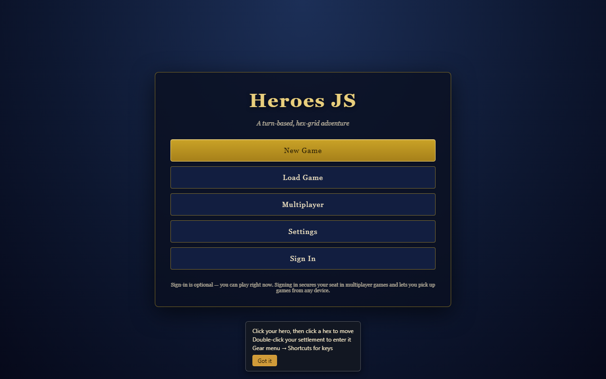
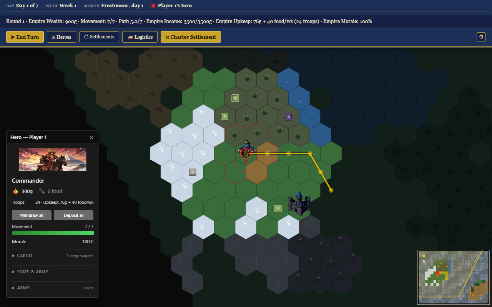
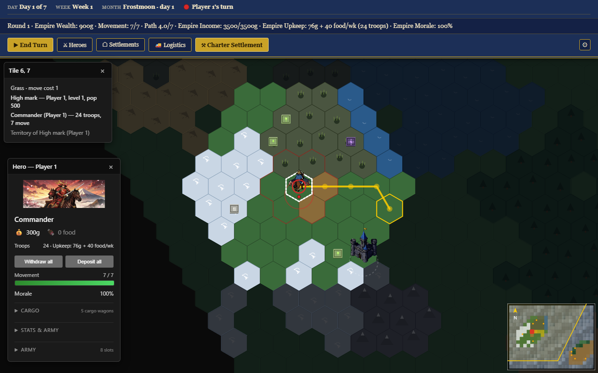

# Heroes JS Documentation

<!-- docs:verified 2026-10-18 -->

This index distinguishes current as-built references, design intent, and historical plans. For current behavior, prefer code-linked as-built documents over older proposals.

## Screenshots

Captured from the Docker deployment (`docker compose up` → http://localhost:5173` → ` http://localhost:5173`); shot set under \`./screenshots/\`, regenerable against pixel baselines with \`npm run test:visual:update-baselines\` (provenance: \`docs/asset-provenance.md\`, \`docs/sprite-pipelines.md\`).

| Screenshot | What it shows |
| --- | --- |
|  | Landing view: New Game / Load Game / Settings / Sign In |
|  | Hex world: selected hero, movement path, fog, HUD/toolbar |
|  | Hero pane: stats, army, cargo |

## Start Here

| Reference | Use it for |
|---|---|
| [Project README](../README.md) | Install, run, and current feature overview |
| [Player guide](./player-guide.md) | New Game options, movement, chartering, combat, logistics, and hotkeys |
| [Operations guide](./operations.md) | Local DB safety, ports, tests, migrations, LAN, AI driver, and deployment |
| [Technical specification](../TECHNICAL_SPECIFICATIONS.MD) | Current system architecture and API/persistence model |
| [Agent instructions](../AGENTS.md) | Workspace safety, verification gates, and release/versioning rules |
| [Current module map](./module-documentation-and-relationships.md) | Current packages and module boundaries |
| [Render technical spec](../src/render/docs/technical-spec.md) | Live renderer and asset architecture |
| [Paint2D boundary](../src/render/scene/paint2d/README.md) | Current scene painter seam |
| [Sprite pipelines](./sprite-pipelines.md) | Asset generation, generated keys/anchors, validation, and provenance gaps |
| [Building sprite generation skill](../.kilo/skills/building-sprite-gen/SKILL.md) | Current Gemini/OpenRouter sprite workflow |

## Reading Model

- **Current/as-built references** describe behavior verified in code. For numeric resource income, use [`resource-gathering.md`](./resource-gathering.md); [`economy.md`](./economy.md) is design intent and points out where implementation differs.
- **Design references** record intended rules or visual direction. They are not proof that a behavior is implemented.
- **Historical plans and PR records** preserve earlier decisions and scope. Their status is called out in the document; do not treat them as current TODO lists without checking the code.

## Current References

| Document | Scope and status |
|---|---|
| [README.md](./README.md) | This catalog and index of the documentation set. |
| [player-guide.md](./player-guide.md) | Player-facing New Game options, movement, chartering, combat, logistics, and hotkeys. |
| [operations.md](./operations.md) | Local development, database/test safety, AI driver, LAN, deployment, and versioning. |
| [asset-provenance.md](./asset-provenance.md) | Existing asset workflows and provenance gaps; metadata to capture for future art. |
| [sprite-pipelines.md](./sprite-pipelines.md) | Current asset generators, generated building keys/anchors, validation gates, and open provenance gaps. |
| [resources.md](./resources.md) | Six game resources; food is not a world-map resource. Current tile rates and food spots. |
| [resource-gathering.md](./resource-gathering.md) | As-built terrain densities, settlement rates, producers, staffing, costs, sinks, and the market-income finding F2 (closed 2026-10-18). |
| [economy.md](./economy.md) | High-level economy design intent; defer to resource-gathering for actual End Turn behavior. |
| [map.md](./map.md) | World map, terrain, visibility, and movement design/current behavior. |
| [map-gen.md](./map-gen.md) | Current procedural terrain generation and alternative approaches. |
| [settlements.md](./settlements.md) | Settlement founding, buildings, capture, upgrades, recruitment, and charter rules. |
| [heroes.md](./heroes.md) | Hero movement, provisioning, charters, upkeep, and battle outcomes. |
| [army.md](./army.md) | Live faction rosters, recruitment, weekly upkeep, battle rules, and arena art. |
| [multiplayer.md](./multiplayer.md) | Lobby/seats, SSE sync, disconnect policy, server-driven AI, and AI chartering. |
| [auth-model.md](./auth-model.md) | Magic-link authentication and per-game seat identity. |
| [event-system.md](./event-system.md) | Typed client event bus and `GameEvent` catalog; listener migration status is documented there. |
| [network-map.md](./network-map.md) | Developer network-topology overlay and what its measured/proxy metrics mean. |
| [dev-console.md](./dev-console.md) | Live event log and developer console. |
| [battle-view-architecture.md](./battle-view-architecture.md) | Current battle flow, manual arena, quick resolve, and server command boundaries. |
| [art-style.md](./art-style.md) | Art direction; use asset-provenance and sprite-pipeline references for actual files and tools. |
| [isometric-building-prompts.md](./isometric-building-prompts.md) | Historical prompt examples; not a complete per-asset provenance record. |

## Architecture and Plans

| Document | Scope and status |
|---|---|
| [module-documentation-and-relationships.md](./module-documentation-and-relationships.md) | Maintained current map for contracts, engine, server, client screens/rendering, tests, and tools. |
| [architecture.md](./architecture.md) | Historical executed `src/` layout plan with later status corrections; not the current module map. |
| [plans-track-map.md](./plans-track-map.md) | Track snapshot dated 2026-10-10 plus a dated current-status update. |
| [pr-13-dev-console.md](./pr-13-dev-console.md) | Historical merged-PR record for the developer console. |

## Historical Plans and Designs

| Document | Current status |
|---|---|
| [CombatResolutionEngine-TechnicalDesign.md](./CombatResolutionEngine-TechnicalDesign.md) | Historical proposal. The engine resolver and manual battle paths are shipped. |
| [city-view-impl-plan.md](./city-view-impl-plan.md) | Historical implementation plan; current city behavior is in settlements and render references. |
| [wagons-stockpiles-trade-routes-plan.md](./wagons-stockpiles-trade-routes-plan.md) | Shipped/superseded plan; as-built logistics are in resources, resource-gathering, heroes, and multiplayer. |
| [terrain-plan.md](./terrain-plan.md) | Historical proposal for battle-grid terrain; distinct from live world-map terrain. |
| [spellcasting-plan.md](./spellcasting-plan.md) | Shipped feature plan retained as design history. |
| [morale-fatigue-plan.md](./morale-fatigue-plan.md) | Shipped feature plan retained as design history. |
| [TODO-front-end-efficiency.md](./TODO-front-end-efficiency.md) | Historical performance backlog; profile the current scene path before acting on items. |
| [ui-top-panel-plan.md](./ui-top-panel-plan.md) | Historical/proposal snapshot, not the current toolbar specification. |

## Current Status Quick Reference

- **Resources:** gold, wood, stone, iron, arcane, and food are game resources. Food is not generated on map tiles; food city spots/buildings, stockpiles, consumption, and weekly upkeep are live.
- **Settlements:** charter founding, capture, building construction/upgrades, garrison recruitment, and resource production are live.
- **Logistics:** wagons and physical caravans are shipped. New games do not use shared-storage teleports; legacy saves retain their recorded compatibility policy.
- **Combat:** hero and settlement-garrison resolvers, the manual arena, and hero defeat/retreat/surrender outcomes are shipped. Human defenders may Fight or Quick Resolve an AI offer; Flee is hidden for defenders. Garrison assaults offer Assault, Auto-resolve, or Cancel.
- **AI:** 0–3 AI enemies can be selected in New Game. Flagged games are server-driven; AI garrison recruitment, trade-route acceptance, chartering, watchdog/heartbeat, token ownership, and per-game advisory locking are live.
- **Factions:** the registry-driven human, Ashen, Ironmark, and Verdant rosters and recruit gates are live; neutral monsters are separate from playable rosters.
- **Workforce (2026-10-17):** per-settlement workers (`floor(population/100)`) scale producer output, market gold, recruit-building draft recharge, and upgrade-timer speed; the `AssignWorkers` command and `WorkersAssigned` event ship end to end, and the first assignment auto-crews the remaining pool (jobs first, then houses).
- **One panel manager, Escape everywhere (2026-10-20):** `screens/shared/panel.ts` (`FloatingPanel`, `panelTheme`, `createPanel`) and `screens/shared/dialog.ts` (`openDialog`) replace `menu.ts`, and `panelManager.ts` replaces `panelStack.ts`. A floating surface is now a **panel**, a centred modal a **dialog**, and a *menu* means an actual command list. `panelManager` holds the single window `keydown` listener, so `Esc` closes the topmost open panel - Settings, New Game, Load Game, Logistics, Keyboard & Mouse, Battle Results, Test Battle Setup, tile info, the hero/settlement panels and rosters, and every city-view panel - with no per-screen Escape code left. Nested state wins the first `Esc` (an active placement, an open tooltip), the City Design box opts out because the city owns it, and hidden long-lived panels never swallow the key. Also fixed: a long-lived panel's × destroyed DOM the game re-shows, and closing the build palette from its own × left the City Design button reading *Close*.
- **City Design panel + resizeable panels (2026-10-19):** the city view's **City Design** box (⚒ Build / ♟ Workforce / ⚔ Recruit / ← Back) is now a normal floating panel — drag it anywhere and the position is remembered (`cityDesign` geometry key), and it joins the panel stack instead of sitting on a fixed high z-index. It has no close button because the city view owns its lifetime (no toolbar entry would reopen it). Every floating menu/panel now carries the recruitment panel's corner resize grip, with the size remembered per panel: hero/settlement panels and their rosters (the grip hides while a roster is docked in the rail), City Design, Workforce, Recruitment, the build palette, building/selection menus, tile info, the game log, and the Keyboard & Mouse, Logistics, Battle Results and Test Battle Setup modals. Confirm prompts and small forms keep their fixed layout.
- **Recruitment panel (2026-10-18; unit-row dropdown 2026-10-19):** the city view gathers every recruit source — main city **and districts** — into one panel opened from the City Design box (⚔ Recruit) or `r`, grouped by building type (one FARMHOUSE block however many farmhouses exist) with that type's `ready/pool` totals, a per-unit `+N/wk` refill rate and cost icon chips, and a per-type **Buy all** (most-stocked building first, then round robin). Each unit's image row is the **parent**: it accordions down one row per building that trains that unit (hidden by default), buys across every one of them (shift-click takes the pooled maximum) and its worker stepper staffs them all at once (`−`/`+` = one worker per building); only a nested building row opens that building's own menu, and the rate follows the staffing. It also mounts the settlement panel's Garrison section — one shared `GarrisonView`, so a transfer on either surface appears on both immediately. Pure client surface: rows commit through the existing `RecruitUnits`, `AssignWorkers` and `TransferUnits` commands, district-true per row.
- **Economy (updated 2026-10-18):** resource-gathering finding F2 is CLOSED — End Turn credits building `goldPerTurn` (a `market` now pays its 40/level into the treasury, scaled by staffing, in both the main city and districts), and `effectiveSettlementIncome()` matches. The gold **tile-rate** projection (`resourceRates.gold`) is still a phantom, not an End Turn credit.

## Local Historical Collections

- [Session plans](../.plans/) are local, gitignored recovery/history records, not source-controlled documentation.
- [Session logs](../sessionTracking/) are a separate historical collection.
- Timestamped plans and session logs are excluded from the maintained-doc freshness checks; the dated status in [`plans-track-map.md`](./plans-track-map.md) is the published project-facing summary.
