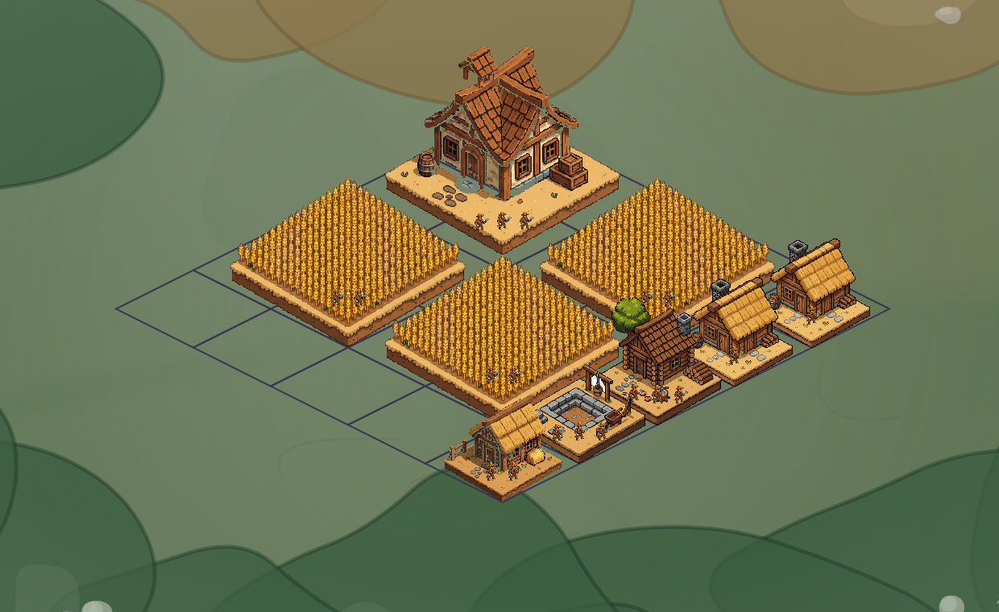
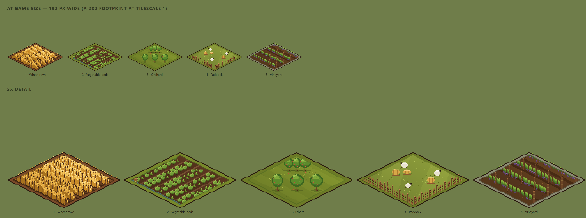
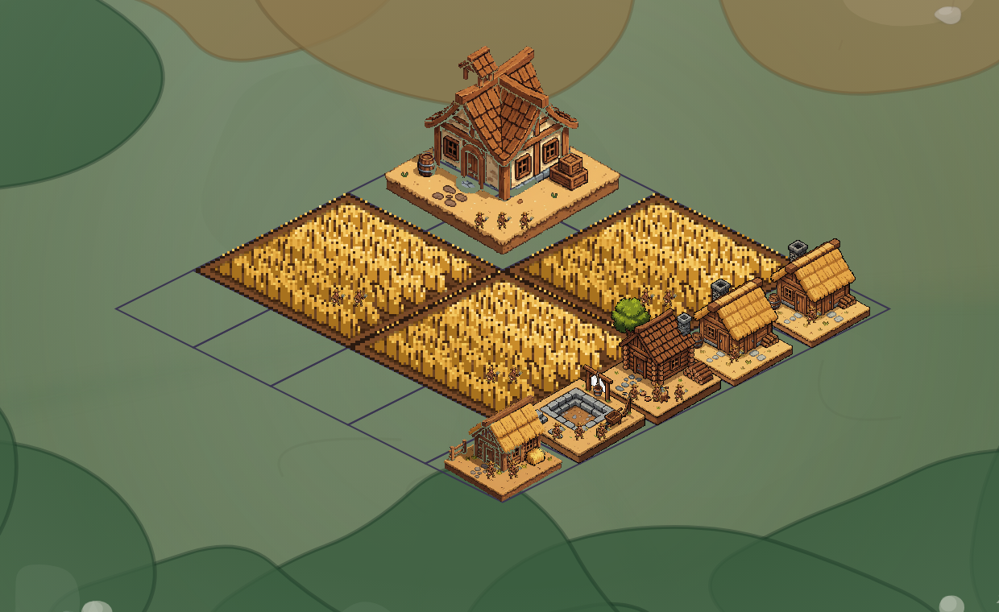
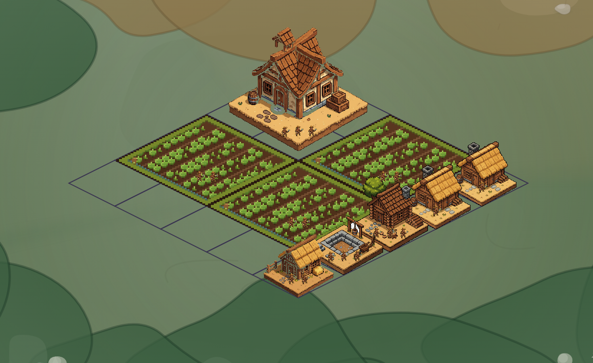
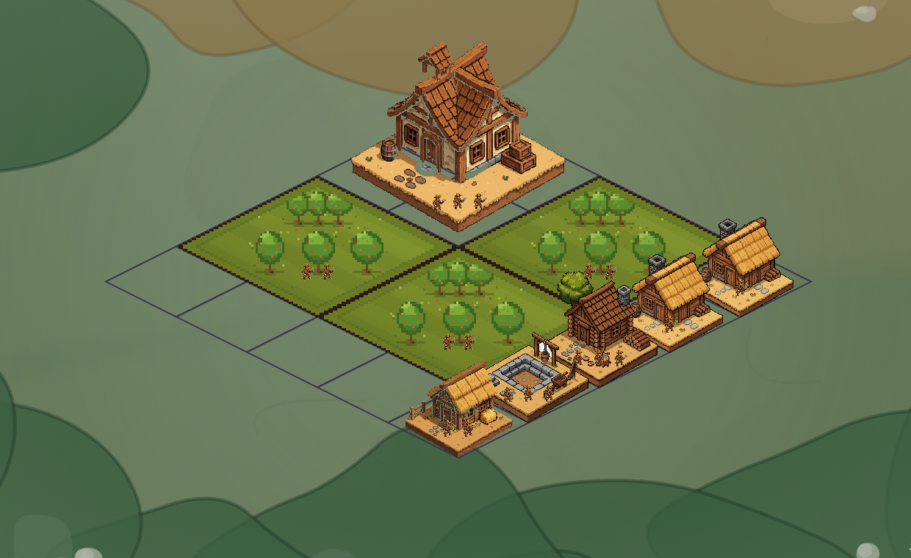
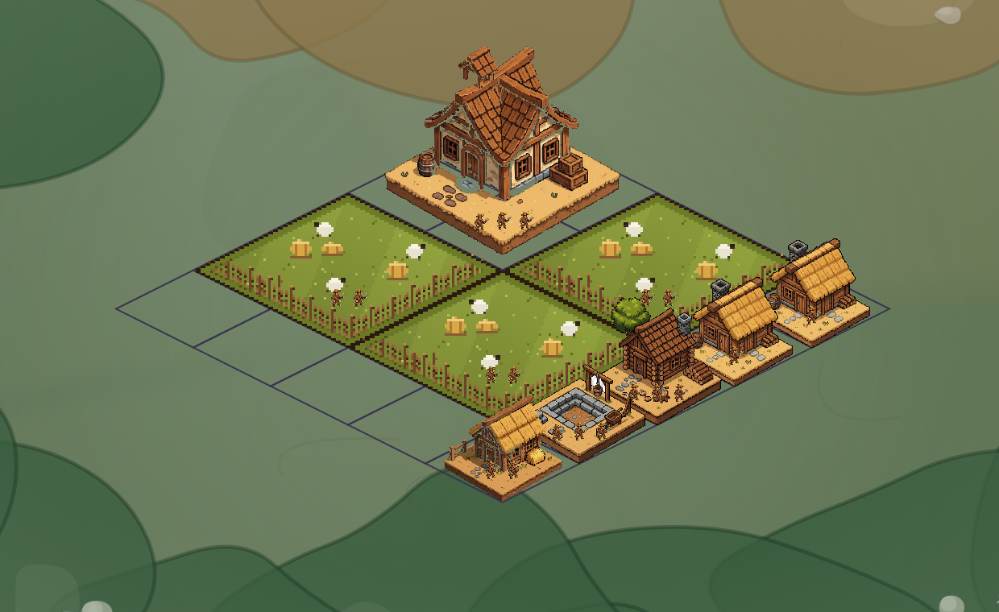
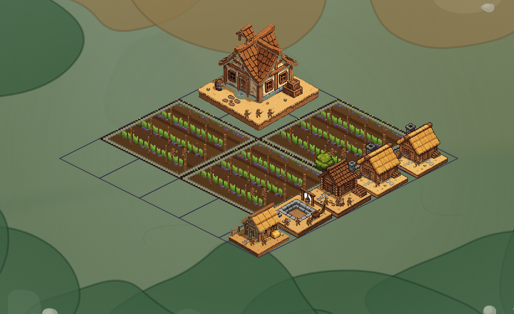
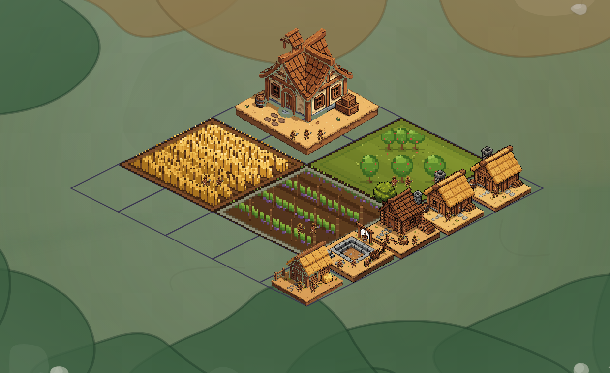

# Farm field sprites — five grid-exact styles

Branch `upgrade-farm-iso`, worktree `.kilo/worktrees/upgrade-farm-iso`.

Every screenshot below is the real city view (dev build, seed 4242, a 5×5 settlement seeded
with three adjacent farm fields), captured with Playwright. The blue lines are the game's
own cell grid (`cityGridLines`), so you can check the fit against the cells directly.

---

## 1. Why the old farms didn't sit in the grid

Measured on `building-pixel-farmField-1.png` (1024²):

| | Old art | Grid | New art |
|---|---|---|---|
| Ground-diamond edge slope (dy/dx) | **0.69** (≈35°) | **0.50** (26.57°) | **0.52** (0.50 + 1px outline) |
| Art content vs canvas width | 845 px = 84.5 % | — | 983 px = 98.3 % |
| Descriptor scale | `hexSizeMul 0.9` | 1.0 | `hexSizeMul 1.0` |
| Visible plot vs 2×2 cell width | **≈ 76 %** (146 / 192 px) | 100 % | **≈ 98 %** (189 / 192 px) |
| Transparent pad under the plot | 121 px (12 % of canvas) | 0 | 0 |
| Plinth at the south vertex | ~72 px (sandy lip + dark side) | none | none |

Three things stacked up: the model drew a ~1.45:1 diamond instead of 2:1, the universal building
descriptor scales to 90 % *and* the art had a 15.5 % margin, and the plot carried a thick soil
plinth (~7 % of the sprite, ≈ 12 px of brown wall at drawn size).

Before — legacy art, same grid:

---

## 2. What these five are

They are **procedurally drawn** — one deterministic Node script,
`tools/sprites/gen-farm-sprites.mjs`, the same pattern as the repo's other script-authored sprite
families. No model in the loop, which is the point: a diffusion model cannot guarantee the
projection, and the projection was the bug.

Geometry contract:

- logical canvas 128×128; the **ground diamond is exactly 128 wide × 64 tall (2:1)**, its south
  vertex is the bottom row of the canvas;
- 8× nearest-neighbour upscale → 1024×1024 PNG, pixel grain in line with the building family;
- `fitWidth` at `hexSizeMul 1.0`, `anchorOffsetY 0` → the diamond lands **exactly on the 2×2
  footprint** (192 × 96 CSS px at tileScale 1), corners on the cell corners;
- **no side wall**: 1 px outline plus a 2–3 px verge, so a plot sits flush in its cells;
- **hard cell clip**: every prop is trimmed to the plot's own diamond, and crops run to the edge, so
  adjacent fields meet edge-to-edge and nothing is sliced by a neighbouring plot's ground;
- byte-stable output with a `--check` drift gate.

---

## 3. The five styles

All five ship together. The one a farm draws is picked per cell from
`farmPlotVariantAt(settlementName, gx, gy)` (FNV-1a hash over the cell → one of five), so a
settlement gets a stable mix and a reload never reshuffles it.

### 1 · Wheat rows — `building-pixel-farmWheat-1.png`

Dense standing wheat on soil furrows, seven rows, seed heads along the back. Reads as a grain field
at any zoom; adjacent wheat plots merge into one field, which is the intended look.

### 2 · Vegetable beds — `building-pixel-farmVeg-1.png`

Five raised beds with two rows of cabbages each, wooden bed lips, and an irrigation channel with a
sluice gate along the front-left edge.

### 3 · Orchard — `building-pixel-farmOrchard-1.png`

Six fruit trees — three larger in front, three smaller behind — on mown grass, with trunks, lit
canopies and apples. The only variant with real vertical silhouette. Tree sizes and positions are
fixed in the generator so every canopy stays inside the diamond.

### 4 · Paddock — `building-pixel-farmPaddock-1.png`

Post-and-rail fence on both front edges with a gate gap, three hay bales, three sheep, tufted grass.

### 5 · Vineyard — `building-pixel-farmVines-1.png`

Four trellis rows: continuous vine hedges with grape bunches, posts and a wire line, on dark tilled
soil with stone edging.

Full-page captures of each variant are kept out of the repo under `local/farm-review/`.

---

## 4. Two fixes from the first review

Both were real bugs in the first cut:

1. **Props bled into the neighbouring plot.** The orchard's canopies and the wheat's back rows
   reached up to 10 logical px outside their own diamond, so whichever plot drew later guillotined
   the other's trees/stalks along a diagonal. Fixed with `clipToPlot()` — every sprite is now
   trimmed exactly to its own diamond, and the measured overflow is 0.25 px (was 10 px). The orchard
   layout was rebuilt (fixed positions, two sizes) so canopies fit instead of being clipped.
2. **A bald strip between fields.** Props were placed with a 4–5 px edge margin, so adjacent crops
   stopped short of the boundary and the seam read as a cut. Margins are now 1.4–2.2 px, so crops
   run to the edge.

The shipped mix, three different variants on three adjacent cells:

---

## 5. Looking at them

The dev client runs at `http://localhost:54238`. Load **farm-iso-review**, then open the settlement:

- no query param → the shipped mix (three different styles in the seeded layout)
- `?farm=farmWheat` / `farmVeg` / `farmOrchard` / `farmPaddock` / `farmVines` → force one style
- `?farm=farmField` → the legacy model art, for comparison

The hook is `farmSpriteStyle` (cityScene input) → `farmSpriteKey` (`CityBuildingNode`) → the painter.
It is a review/debug convenience; the default path never needs it.

---

## 6. Future: farms as explicit building kinds

Not done, by request. The pieces are already shaped for it: each style is its own keyed sprite
(`building-pixel-<variant>-1.png`), the variant list lives in one place (`FARM_PLOT_VARIANTS` in
`packages/engine/src/styleResolver.ts`), and the pick is a single function. Promoting a variant to a
`BuildingKind` with its own goods is a registry change (footprint, cost, `settlementEffects`,
palette section) on top of that list — no re-art required.
