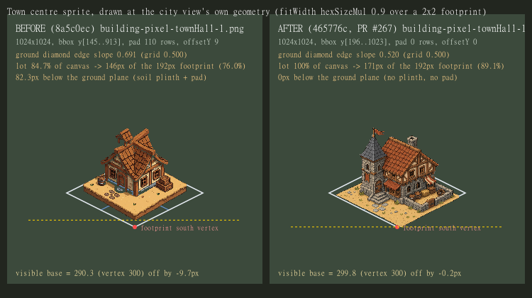
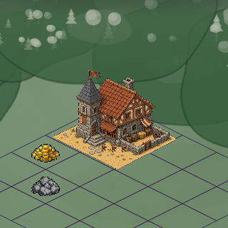

# Town centre sprite — audit, and the test that proves it

Branch `wtgui/audit-settlers-town-center-sprite-defect-51a31d`, worktree
`.worktrees/audit-the-town-center-sp-51a31d`. The test is
[`test/townCenterSprite.e2e.ts`](../../test/townCenterSprite.e2e.ts), run with
`npm run test:towncenter` (or `node --no-deprecation tools/run-test.mjs towncenter --auto-close`).

No art was changed by this audit.

## 1. Which asset the town center renders

The town center is the **town hall** — the 2x2 building that owns the city grid's reserved
centre cell ([`docs/settlements.md`](../settlements.md), "Town Hall at center"). Its art resolves
through the engine's own chain, which the suite asserts rather than assumes:

| step | value |
| --- | --- |
| kind | `townHall` (`packages/contracts/src/buildings.ts`) |
| style | `pickStyleForBuilding("townHall", 1, "pixel")` → `"pixel"` (`packages/engine/src/styleResolver.ts`; the no-preferred-style fall-through reaches the same art) |
| sprite key | `pixel.townHall.1` |
| file | **`src/resources/buildings/building-pixel-townHall-1.png`** (`BUILDING_SPRITE_FILES`, generated from the files on disk) |
| descriptor | `BUILDING_DESCRIPTORS["building.pixel.townHall.1"]` — anchor `bottom`, sizing `fitWidth` `hexSizeMul 0.9`, `anchorOffsetY` from `src/render/generated/buildingAnchorOverrides.ts` |

A settlers town starts with **no buildings** (`freeStarterBuildings: false`), so this asset is
rendered when the player builds the town hall in the founded town's city view — the state in the
audit's source screenshot. (The adventure map's settlement sprite is a different asset entirely:
`castle.1.v0.f1` → `src/resources/settlements/settlement-l1-v0-f1.png`.)

## 2. What was wrong with it (the pre-fix art, `main` @ `8a5c0ec`)

`building-pixel-townHall-1.png`, md5 `13d797d845163377cbc8566d763384df`, 1024x1024 RGBA,
alpha bbox `x[77..943] y[145..913]`:

- **Wrong projection.** Its ground diamond's edge slope is **0.691** (≈1.45:1) against the iso
  grid's **0.500** (2:1) — the same defect the five farm plots had before the farm wave
  ([`farm-options.md`](../farm-review/farm-options.md) measured their legacy art at 0.69).
- **A thick ground plinth.** The lot is a raised platform: **82.3px of silhouette sits below a 2:1
  diamond of its own width** (a soil wall), on top of a **110-row transparent bottom pad** (10.7% of
  the canvas). The grid-exact farm reference measures 11px and 0 rows.
- **A margin, not a lot.** The ground diamond fills only **84.7%** of its canvas (farm reference:
  98.4%), and drawn at the family's `hexSizeMul 0.9` it covered **146px of the 2x2 footprint's
  192px (76.0%)** — the farm review's exact legacy number.
- **A floating base.** `pixel.townHall.1`'s generated anchor offset was **9**, computed from the
  1x1 draw height (86.4) even though the town hall is a 2x2 building whose drawn height is 172.8 —
  the convention `src/render/assetDescriptors.ts` documents ("Other 2x2 buildings (e.g. townHall)
  deliberately keep 86.4"). The pad therefore needed **18.56**; the half-correction left the
  sprite's visible base **10.8px above the footprint's south vertex** in a real city view.



## 3. The test

`test/townCenterSprite.e2e.ts` reports every check before it throws, so one run is the whole
defect list. 25 checks in two halves:

- **A0-A5, per level (1, 2, 3)** — offline, from the resolved PNG: the resolution chain; the ground
  diamond's projection; the transparent bottom pad; the lot's share of the canvas; nothing hanging
  below the ground plane; and the anchor offset against the art's real draw height.
- **B0-B5** — the same sprite as rendered, in a real settlers game on a local dev server: create a
  settlers game through the API, load it in the browser, found the town with the toolbar's own
  gesture, open its city view, place the town center through the build palette, then measure the
  sprite off two screenshot frames of the same crop (before/after) against the grid geometry the
  city view itself uses (`src/core/cityGrid`): the visible base against the 2x2 footprint's south
  vertex, the drawn lot against the footprint, and the drawn edge slope.

Every tolerance is calibrated on the repo's own grid-exact reference art
(`building-pixel-farmWheat-1.png`: slope 0.522, pad 0, 98.4% of canvas, 11px below a 2:1 diamond),
so the standard is the farm family's. One threshold is the render's, not the art's: the drawn lot's
coverage floor is **85%**, because every building sprite is drawn at the universal `hexSizeMul 0.9`
inset (the farm plots reach 100% only by overriding it in `GRID_EXACT_FARM_STYLES`).

### Verdict

| tree | verdict |
| --- | --- |
| `8a5c0ec` (the art in the source screenshot) | **FAILS, 8 of 14 checks** — A1-A5 and B3-B5 |
| `465776c` (`main`, after PR #267 re-arted level 1) | **level 1 passes all 15 of its checks; levels 2 and 3 still fail all 5 art checks each** |

Level 1 after PR #267 — `building-pixel-townHall-1.png`, md5
`98832a57cf755fbe5c3469a4ec233487`, alpha bbox `x[0..1023] y[196..1023]`, pad **0**, slope
**0.520**, lot **100%** of canvas, anchor offset **0**: rendered base **-0.8px** off the footprint's
south vertex (was -10.8px), drawn lot **171px of 192px (89.1%)** (was 76.0%), rendered edge slope
**0.529** (was 0.685).



### Still open

- **Levels 2 and 3 were not re-arted.** `building-pixel-townHall-2.png` (slope 0.688, pad 107,
  lot 84.7%, 81.3px below the ground plane, anchor 9 vs 18.06 required) and
  `building-pixel-townHall-3.png` (0.669, 70, 85.5%, 6 vs 11.81) carry the old diorama art, so a
  settlement that upgrades its town hall gets the plinth and the floating base back. The suite
  asserts all three levels for exactly that reason.
- **A freshly placed town hall renders as a construction site.** A town hall is stamped
  `{ daysRemaining: 0 }` (`buildDays: 0`, `sanitize` in `packages/engine/src/settlement/placeBuildings.ts`),
  which is still a truthy `construction`, so the city view paints
  `building.pixel.underConstruction.<stage>` for it — and `buildingConstructionProgress` divides by
  that 0-day total, so the stage is `NaN` → 1. The suite advances one turn (which drops the stamp in
  `advanceBuildingConstructions`) and asserts the stamp is gone before it measures, or it would be
  measuring the placeholder. Worth its own card.

## 4. Reproducing

```bash
cd .worktrees/audit-the-town-center-sp-51a31d
export PGDATABASE=game_poc_wtgui_audit_the_town_center_sp_51a31d   # per-worktree DB, .env.test pins game_poc
npm run test:towncenter
```

The run writes its two frames to `local/audit-town-center/` (gitignored) and prints their paths.
`tools/run-test.mjs` must not be backgrounded on this box (a backgrounded node script dies with
`stdin is not a tty`); run it in the foreground.
