# Playtest: first-session (2026-10-18)

- Build: v0.14.0 (763531a)   <!-- package.json + git rev-parse; gear menu not opened -->
- Game: playtest-20261018-first-session (id 2912) · seed 230337447 (castleSeed 1859901651) · Small 24×18 · 1 human / 1 AI · The Ironmark Holds (AI seat: Crownlands)
- Played: 5 turns (now day 6 / round 6), ~75 actions · Dev env started by playtester: yes (`npm run dev`; `game_db` was already up)

## Summary

The game ran without console errors, rejected commands or stuck phases for 5 turns, and state survived a full page reload. But the first session is lopsided. The AI lost its only hero to my starting army on turn 3, never recruited a replacement or built anything, and a fresh 7-troop hero captured its level-3 capital on turn 5. After that the game simply continues: there is no victory feedback. The worst player-facing bug is that double-clicking your own settlement to open its city (the documented door) walks the selected hero there first, spending its whole turn of movement. Faction choice is shallow on day one. An Ironmark player starts with Crownlands units, the starter Farmhouse recruits nothing for them, and the build palette lists all four factions' troop buildings with nothing to say which ones work. What felt good: the city view, the placement preview, Assault/Cancel/Auto-resolve, and the manual battle all worked, and the "No path there" and "Out of movement" toasts were clear.

## Findings

### [BUG] [major] Double-clicking your own settlement walks the selected hero there and spends its movement
- Steps: seed 230337447, turn 1. Move the Commander away from Storm fall (7,7) to (8,3), end the turn. On turn 2, with the Commander still selected, double-click Storm fall on the map to open its city.
- Expected: the city opens and the hero stays put (docs/player-guide.md: "Double-click a settlement to enter its city view.").
- Actual: the city opens, but the first click is taken as a move order. The hero walked 8,3 → 7,7 (`move_completed cost 6.8`, `movementRemaining 0.2`) and a "No path there" toast appeared. On repro 2 (turn 3, hero at 6,5 with 2.6 movement) the hero moved to 6,7, used all 2.6 movement, and "Out of movement — the rest continues next turn" appeared, so a path to the settlement was queued.
- Evidence: 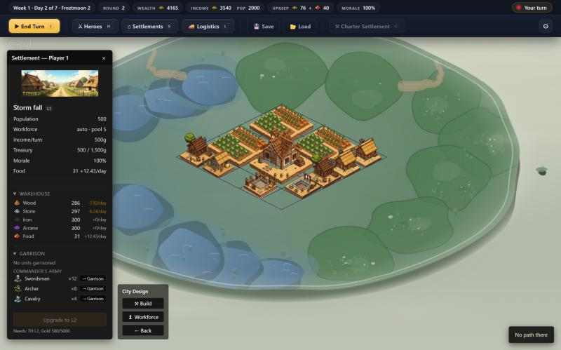, 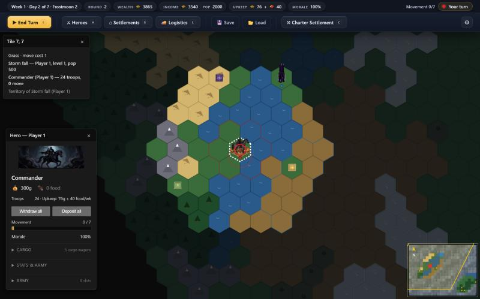, 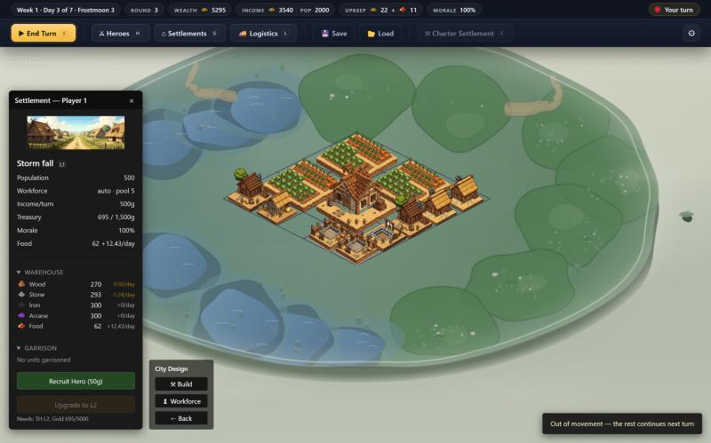; event log `hero:moved {from:{8,3}, to:{7,7}}`, `move_completed {cost:6.8}`; then `hero:moved {from:{6,5}, to:{6,7}}`, `move_completed {cost:2.6}`.
- Repro: confirmed ×2

### [BALANCE] [major] AI collapses in 5 turns: it never replaces its hero, idles on 10,000 gold, and loses its capital to 7 troops
- Steps: same game. Turn 3: attack the AI hero Warlord (10 crossbowmen, 3 griffins) with the starting Commander (12 swordsmen, 8 archers, 4 cavalry) through Fight. Recruit a hero at Storm fall for 50g (2 peasants, 3 archers, 2 pikemen). Walk her to Dragon gate (10,10) and Auto-resolve the assault on turn 5.
- Expected: a server-driven AI that rebuilds, recruits and defends (docs/heroes.md: AI heroes move automatically during `AI_TURN` via the engine brain).
- Actual: from round 3 on, the AI had `heroIds: []`. Its building count stayed at 19 and its treasury sat at the 10,000 cap (income about 15,000/day, wasted). Its only spending was peasants, taking the garrison from 9 to 12. The 7-troop hero won in 4 rounds, and the AI ended with no heroes and no settlements. The AI did walk its hero straight at mine on turns 1–2. The game shows no victory or elimination screen and keeps running AI turns (`ai_turn_started`) for a player with nothing left. No victory rule is documented anywhere in docs/.
- Evidence: 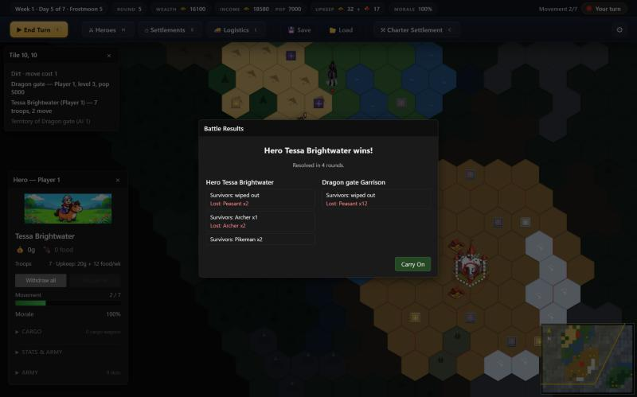; `players[1] = {heroIds:[], settlementIds:[]}`; `settlement_battle_resolved {outcome:"attackerWon", captured:true}`.
- Repro: confirmed ×1 (one playthrough; the state was checked every turn for 3 AI turns)

### [UX] [major] Faction choice doesn't carry into the opening: Crownlands starting army, no recruitable unit, unlabeled palette
- Steps: New Game → The Ironmark Holds. Open Storm fall → click the Farmhouse. Open the Build palette.
- Expected: an Ironmark seat gets Ironmark units, and the starter set lets it "raise garrison troops from the moment it exists" (docs/settlements.md, starter-set paragraph). docs/army.md: Ironmark units are "only" recruitable at Forge Hall / Gunners' Redoubt / Golem Foundry / Deep Anvil.
- Actual: the starting Commander has swordsmen, archers and cavalry (`init.ts` hard-codes a Crownlands army), and a recruited hero gets peasants, archers and pikemen. The starter Farmhouse menu has no recruit section for an Ironmark seat, so it has nothing to recruit. The palette lists all 19 troop buildings from every faction (Barracks, Crypt, Grove Sanctum, Forge Hall, …). Each one's tooltip only shows upkeep, with no faction or recruit list. As a new Ironmark player I spent my whole 300g treasury on a Barracks that can never recruit for me. docs/army.md says these buildings are "buildable by anyone but only recruiting for" their faction, so this is by design, but nothing in the game tells the player.
- Evidence: 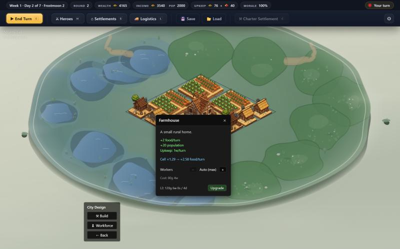; palette `title` = "Upkeep: 2 wood, 1 stone per turn" for both Barracks and Forge Hall.
- Repro: confirmed ×2 (starting army, and the recruited hero's army)

### [UX] [minor] Build palette's Confirm/Cancel and "Cart" imply a pending order, but placement commits on click
- Steps: city view → Build → select Forge Hall → click a free cell. Treasury drops 500 → 200 right away. Then click Cancel.
- Expected: Cancel discards an unconfirmed placement, or there is no Cancel.
- Actual: `PlaceBuildings` runs on the grid click (state shows `forgeHall` with `construction.daysRemaining 5`). Cancel does not refund (gold stays 200, the building stays). Reopening the palette still shows "Cart: +300g +10w +6s" with an enabled Confirm, though that cost is already paid. Clicking Confirm sends a no-op `buildings_placed`. Nothing is charged twice.
- Evidence: 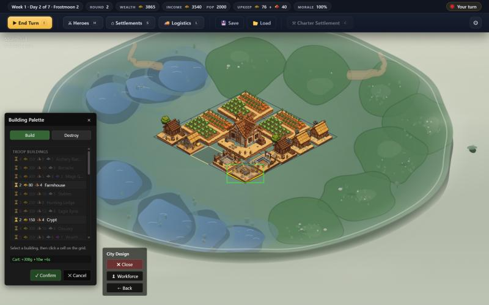 (top bar wealth already reduced); `buildingPlacer.ts` `computeNetCost` counts everything since the view opened.
- Repro: confirmed ×2 (Barracks turn 1, Forge Hall turn 2)

### [UX] [minor] Hero-vs-hero battle UI shows raw hero IDs and the dev "Test Battle" title
- Steps: attack the AI hero with the starting Commander → Fight.
- Expected: hero names (Commander vs Warlord) and an in-game title.
- Actual: the modal says "Hero p0-hero vs Hero p1-hero", the arena top bar reads "Test Battle — Manual Fight" with "You: Blue" (the player is red on the map), and the result card reads "Hero p0-hero wins! / Hero p1-hero was slain". A settlement assault by a recruited hero shows "Hero Tessa Brightwater" and an "Assault on Dragon gate" title, so only the hero-vs-hero path is affected (`GameActions.ts` ~L135/151, and no `title` passed, so it falls back to `openManualBattleArena`'s "Test Battle — Manual Fight"). Platoons are labelled P1/P2/P3 in the arena rail.
- Evidence: 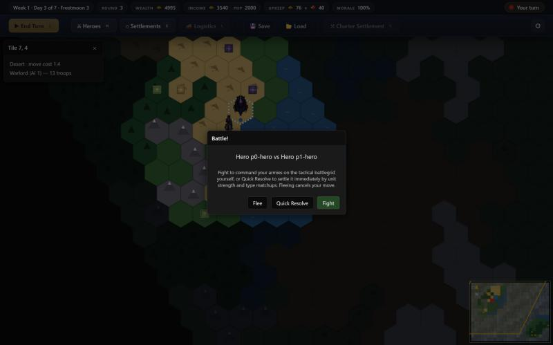, 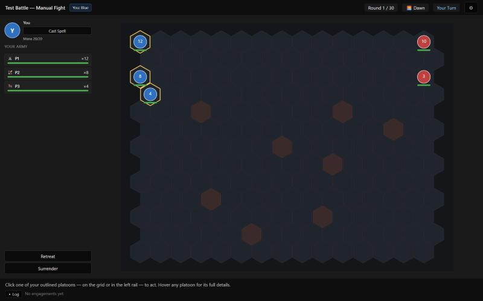, 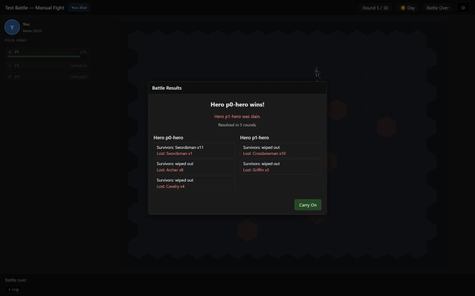
- Repro: confirmed ×1 battle, 3 screens

### [UX] [minor] Recruited hero has 0 wagons and 0 treasury carts; "Withdraw all" is enabled but silently does nothing
- Steps: Storm fall (treasury 645, no hero present) → Recruit Hero (50g) → Recruit. Select the new hero on the settlement → Withdraw all.
- Expected: docs/heroes.md: "`recruitHero` allocates 5 + 5 from the player's two pools". If the pools are empty, the player should be told, and Withdraw all should be disabled or explain the 0 cap.
- Actual: the player's pools were already fully assigned (`wagonsUnassigned 0`, `treasuryWagonsUnassigned 0`), so the hero has `wagons 0, treasuryWagons 0` (gold cap 0, which also means no charter purse). Withdraw all stays enabled. Three clicks, including a double-click, changed nothing, raised no toast and logged no rejection.
- Evidence: 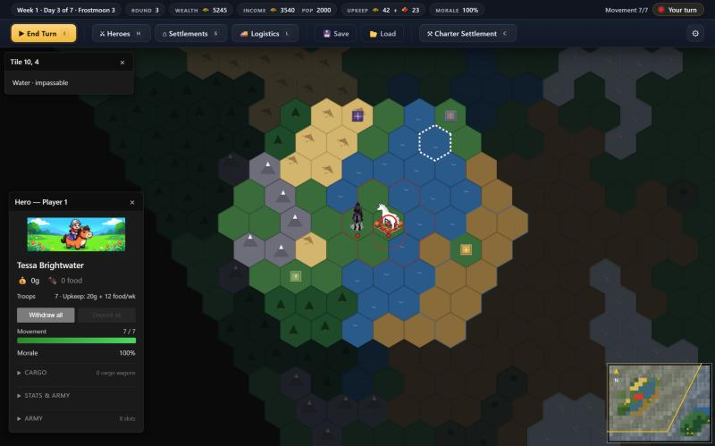; `h0.gold 0`, settlement gold unchanged 645.
- Repro: confirmed ×2

### [UX] [minor] Panels go stale after a settlement capture
- Steps: auto-resolve the assault on Dragon gate → Carry On.
- Expected: the tile and hero panels update.
- Actual: the tile panel reads "Dragon gate — Player 1" but also "Territory of Dragon gate (AI 1)". The hero panel still says "Troops 7" after the hero lost 4 (3 left). Both corrected at the next turn.
- Evidence: 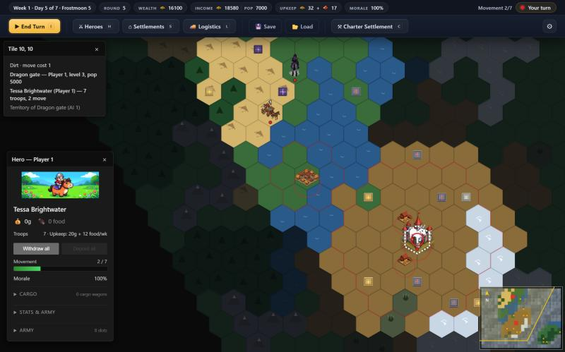
- Repro: confirmed ×1

### [UX] [minor] Load Game list shows "turn 1" for a game on round 6
- Steps: reload the page → Load Game (round 3), and later toolbar Load (round 6).
- Expected: the current turn.
- Actual: "turn 1 · 15295g", then "turn 1 · 16100g". The gold updates; the turn never does (`entry.server.turn` in `loadGameModal.ts` / `homeView.ts`). The delete button reads "Delete" on the home screen but "Forget" in-game.
- Evidence: 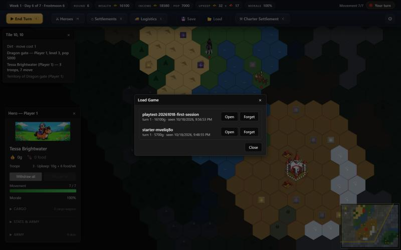
- Repro: confirmed ×2

### [BALANCE] [minor] Treasuries hit their caps by day 3–5, so most early income is wasted
- Observed: Ember mark (L2, 3,000/day tax) reached its 4,000 cap on day 3. Storm fall reached its 1,500 cap on day 5. The AI's L3 sat at its 10,000 cap from day 2. The top bar still advertises Income 3,540, later 18,580. Seat asymmetry: human 2 settlements, pop 2,000, about 3,500/day; AI 1 L3, pop 5,000, about 15,000/day. That matches `HUMAN_CASTLE_COUNT = 2` + `levelForIndex`, but docs/settlements.md still says "Each faction gets one."
- Repro: observed every turn (×5)

## Unconfirmed

- The tile info panel labels any tile outside current vision "Unexplored" (`tileInfoPanel.ts` uses current visibility). The AI capital, 6 hexes from the start, showed "Unexplored" with Uncharted mode off. That may be intended fog; the word is misleading for previously seen tiles.
- After the first `navigate`, the save list already held a `starter-mveliq8o` game (created 09:48:55, before mine). It looks like the home screen silently creates a starter game; I did not trace it.
- The first-run hint ("Click your hero, then click a hex to move…") appears over the home menu before any game exists.

## Shortcuts taken

None. Everything went through the UI; `__gameDebug` was used read-only (`getState`, `getHeroes`, `screenFor`, `isPassable`, `events`).

## Worked as documented

- New Game form: name, faction chips, map size, human/AI counts, seed reroll; created on the server-driven path.
- City view: starter layout on first open, placement preview (green/invalid), placement charges cost, construction timers tick (Barracks 5 → 4 days).
- Esc does not dismiss the pending battle modal; Fight opens the manual arena; a hero defeated at 0 troops is removed and its purse looted (300 → 600g); after the battle the phase returns to PLAYER_TURN.
- Settlement assault modal: Cancel leaves the hero on the tile, logs `settlement_battle_cancelled`, and stays in PLAYER_TURN; clicking the tile again re-opens it; Auto-resolve captures and transfers ownership.
- Impassable water gives "No path there"; a partial path gives "Out of movement — the rest continues next turn" and the route resumes on a later click.
- Recruit Hero appears only when no hero stands on the settlement and charges 50g.
- Full page reload → Load Game → identical state (round, gold, heroes, buildings).
- End Turn button and `E` shortcut; AI turns took about 10 s with no stalls; daily income, food and production ticks were applied; the trade-route recommendation toast appeared.
- No console errors and zero `command:rejected` events all session.
